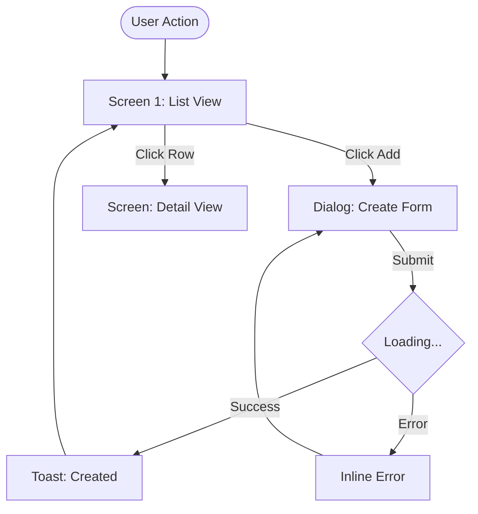
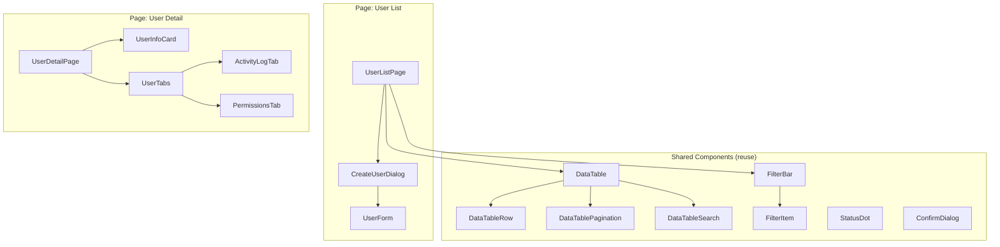

## EXECUTION CONTRACT

Steps 0→5 sequential (incl. Step 2.5). Gate (Step 0) decides whether to run or skip.

**DO NOT:** skip gate check (Step 0), generate contract without design.md/srs.md, validate without api_contract.md existing, update memory without completing the action.

---

## SHARED RULES

> 📖 Base rules: See [`_shared_rules.md`](./_shared_rules.md) for: **CONTEXT PRIORITY**, **ANTI-HALLUCINATION**, **TOOL PRIORITY**, **DIFF AWARENESS**.

### Contract-specific Overrides

- **CONTEXT PRIORITY**:
  | # | Source | Override Rule |
  |---|--------|--------------|
  | 1 | `design.md` + `srs.md` | API endpoint definitions — source of truth for generate mode |
  | 1 | `api_contract.md` (existing) | Source of truth for validate mode |
  | 2 | `tasks.md` (completed) | Handler file paths, implementation status |
  | 3 | `brainstorm_notes.md` + `pre_openspec.md` | Design direction, FR list, scope, classifications |
  | 3 | `business_analysis.md` (from `research/`) | Use cases, actors, data flows, business rules |
  | 4 | `openspec/specs/design-guidelines.md` | Shared design system — colors, typography, layout, components |
  | 5 | `.memory/contract_state.md` | Gate rules, status tracking |
  | 6 | Project conventions | Response wrapper format |

- **ANTI-HALLUCINATION**: Same base. DO NOT invent endpoints not in design.md. DO NOT add fields not in SRS. DO NOT invent screens or components not derivable from use cases + API endpoints.

---

**Pipeline Position**: 

```
GENERATE mode:  /wf_openspec → [GATE] → /wf_api_contract → /wf_fe_spec
VALIDATE mode:  /wf_openspec_apply → [GATE] → /wf_api_contract --validate → /wf_fe_spec
```

**Input**: Change name (kebab-case).

**Modes**:
- **Generate**: `api_contract.md` does NOT exist → extract from design artifacts
- **Validate**: `api_contract.md` EXISTS → verify against backend implementation

---

## STEP 0 — Gate Check

> **Purpose**: Decide whether API Contract workflow should run.
> **Gate Rules**: Read from `.memory/contract_state.md` → `gate_rules` section.
> **User can define custom rules later** — gate is pluggable.

### 0a. Read Gate State

Check `openspec/changes/<name>/.memory/contract_state.md`:

```yaml
gate_rules:
  frontend_active: true     # Primary gate — is frontend pipeline active?
  auto_generate: true       # Auto-generate after openspec completes?
  require_validation: true  # Require validation before fe_spec?
  # Custom user rules can be added here
```

### 0b. Evaluate Gate

| Condition | Action |
|-----------|--------|
| Memory file NOT found | → **ASK USER**: "Frontend pipeline active? (y/n)" → create memory file |
| `frontend_active: false` | → **SKIP** entire workflow. Log: `"⏭️ API Contract skipped — frontend not active"` |
| `frontend_active: true` + `api_contract.md` NOT exists | → **GENERATE** mode |
| `frontend_active: true` + `api_contract.md` EXISTS | → **VALIDATE** mode |
| Custom `gate_rules.*` | → Evaluate user-defined rules. Unknown rules → WARN + continue |

### 0c. Create Memory File (if missing)

If `.memory/contract_state.md` does not exist → create from template:

```yaml
---
# Contract State — Auto-managed by wf_api_contract
# User-editable: gate_rules section
# DO NOT manually edit other sections unless debugging
contract_version: null
backend_status: pending
frontend_status: pending
last_generated: null
last_validated: null
endpoints_count: 0
drift_detected: false
drift_log: []
consumers:
  - platform: web
    workflow: wf_fe_spec
    status: pending
gate_rules:
  frontend_active: true
  auto_generate: true
  require_validation: true
---
```

**Validate:** Gate evaluated, mode determined, memory initialized.

---

## STEP 1 — Load Context (Mode-Dependent)

### Generate Mode

Read from change directory:
1. `design.md` → endpoint definitions, class mappings, DTO structures
2. `srs.md` → validation rules, error codes, functional requirements
3. `tasks.md` → handler file paths (for OpenAPI link reference)

> ⚠️ LAZY LOAD: Read design.md first. Only load srs.md sections relevant to endpoints found. DO NOT load full srs.md upfront.

### 1b. Load Upstream Context (MANDATORY — Both Modes)

Load context from previous workflow stages to ground UI/UX design:

| Source | Path | Purpose | Required |
|--------|------|---------|----------|
| `pre_openspec.md` | `openspec/changes/<name>/pre_openspec.md` | FR list, feature type, scope, classifications | ⚠️ Required in Generate Mode (skip in standalone/Mode D) |
| `brainstorm_notes.md` | `openspec/changes/<name>/brainstorm_notes.md` | Design direction, pre-classifications, open questions | ⚠️ Optional (skip silently if missing) |
| `business_analysis.md` | `openspec/research/<name>/business_analysis.md` | Use cases, actors, data flows, business rules, exception flows | ⚠️ Optional (skip silently if missing) |
| `design-guidelines.md` | `openspec/specs/design-guidelines.md` | Shared design system: colors, typography, layout, component conventions | ✅ YES |

**Lazy load rules:**
- `pre_openspec.md`: Read `> **Type**:` + `## 10. DETECTED SCOPE` only
- `brainstorm_notes.md`: Read `## Selected Direction` + `## Open Questions for Design Phase` only
- `business_analysis.md`: Read `## 2. Use Cases` + `## 5. Data Flow` sections only
- `design-guidelines.md`: Read `## 4. Spacing & Layout` + `## 5. Component Conventions` + `## 6. Interaction States` sections only (partial load — full file loaded in Step 2.5)

**Validation:**
- If `brainstorm_notes.md` has `[OPEN]` questions → inject as `⚠️ DESIGN DECISION NEEDED:` markers in ui_design_spec
- If `business_analysis.md` has Use Cases → extract screen flows for user flow diagram
- If `design-guidelines.md` missing → WARN `"⚠️ No design-guidelines.md found. UI design will use skill defaults."` → continue

### Validate Mode

Read:
1. `api_contract.md` → existing contract (source of truth)
2. Backend source files → verify implementation matches contract
3. `.memory/contract_state.md` → previous validation results
4. `ui_design_spec.md` → existing UI design spec (if exists, validate consistency)

**Validate:** Required context loaded per mode, upstream context loaded.

---

## STEP 2 — Execute (Mode-Dependent)

### Generate Mode — Create `api_contract.md`

#### 2a. Extract Endpoints

Parse `design.md` for HTTP endpoint definitions:
- Method + Path (e.g., `POST /api/v1/auth/login`)
- Request DTO → map fields
- Response DTO → map fields

#### 2b. Build TypeScript Interfaces

For each endpoint, generate TypeScript interfaces:

**Visibility rules:**
| Field Type | Visibility | Example |
|-----------|-----------|---------|
| API response fields | `public` | `id`, `email`, `displayName` |
| Audit fields | `internal` | `createdBy`, `updatedBy`, `deletedAt` |
| Soft-delete flags | `internal` | `isDeleted`, `deletedAt` |
| Internal IDs | `internal` | `internalSeqId`, `auditTrailId` |
| Security tokens (backend) | `internal` | `passwordHash`, `salt` |

#### 2c. Extract Error Codes

Map SRS error specifications → error table:
| Code | HTTP Status | Description | Frontend Action |
|------|------------|-------------|-----------------|

Frontend Actions: `toast` | `modal` | `redirect` | `field-error` | `retry`

#### 2d. Add Response Wrapper

Include project's standard API response envelope from conventions.

#### 2e. Add State Contracts

Define frontend state shape matching response interfaces.

#### 2f. Write Contract

Write `openspec/changes/<name>/api_contract.md` using template: `skills/api-contract-generator/templates/api_contract.template.md`

Set headers:
```markdown
<!-- contract-version: 1.0 -->
<!-- backend-status: pending -->
<!-- frontend-status: pending -->
<!-- generated-by: wf_api_contract -->
<!-- generated-at: {ISO 8601 timestamp} -->
```

---

### Validate Mode — Verify Backend Compliance

#### 2a. Load Contract

Read `api_contract.md` → extract all endpoints and expected DTOs.

#### 2b. Verify Implementation

For each endpoint in contract:
1. ✅ Handler/controller file exists (search in `tasks.md` completed items or `grep_search`)
2. ✅ Request DTO fields match contract Request interface
3. ✅ Response DTO fields match contract Response interface
4. ✅ Error codes are implemented in handler

#### 2c. Flag Drift

If mismatch found:
```
⚠️ CONTRACT DRIFT DETECTED
━━━━━━━━━━━━━━━━━━━━━━━━━━
Endpoint:  POST /api/v1/auth/login
Issue:     Response field 'avatar' in contract but not in backend DTO
Severity:  MEDIUM
Action:    Update api_contract.md OR add field to backend DTO
━━━━━━━━━━━━━━━━━━━━━━━━━━
```

Log drift to `.memory/contract_state.md`:
```yaml
drift_detected: true
drift_log:
  - endpoint: "POST /api/v1/auth/login"
    issue: "Response field 'avatar' missing in backend"
    severity: MEDIUM
    detected_at: "2026-08-11T15:00:00+07:00"
    resolved: false
```

#### 2d. Update Contract Status

If ALL endpoints pass validation:
```markdown
<!-- backend-status: implemented -->
```

---

## STEP 2.5 — UI/UX Design Spec (Generate Mode Only)

> **Purpose**: Bridge the gap between API Contract and Frontend Tasks. Produce a comprehensive UI design specification that guides code implementation toward premium, user-friendly interfaces.
> **Output**: `openspec/changes/<name>/ui_design_spec.md`
> **Generate Mode**: Full spec generation (Steps 2.5a–2.5g)
> **Validate Mode**: Verify existing spec consistency with contract (Step 2.5h)
> **Skills referenced**: `design-taste-frontend`, `ui-ux-designer`, `antigravity-design-expert`, `mobile-design`

> 📖 **Full context load**: Read ALL sections of `openspec/specs/design-guidelines.md` (overrides partial load from Step 1b).

### 2.5a. User Flow Diagram

Generate Mermaid flowchart from loaded context:

**Sources (priority order):**
1. `business_analysis.md` → Use Cases (UC-xx) with Basic Flow + Exception Flows
2. `srs.md` → Functional Requirements (FR-xxx)
3. `design.md` → endpoint definitions (infer screen transitions from API calls)
4. `brainstorm_notes.md` → Selected Direction (design approach)

**Output:**
```markdown
## 1. User Flow Diagram

### Primary Flow: <UC name>


### Exception Flows
| ID | Trigger | Screen State | User Action |
|----|---------|-------------|-------------|
| E1 | 401/403 | Redirect | → Login page |
| E2 | 500/Network | Error banner | Retry button |
| E3 | Empty data | Empty state | CTA to create |
```

**Rules:**
- ONE diagram per Use Case (max 5 per change)
- Include: screen names, transitions, loading states, error branches
- Use business_analysis exception flows directly (E1, E2, E3...)
- If no business_analysis → derive from API error codes in contract

### 2.5b. Screen Inventory & Layout

Derive screen list from user flows + API endpoints:

```markdown
## 2. Screen Inventory

| # | Screen Name | Route | Layout Pattern | Key Components | Auth Level | Priority |
|---|-------------|-------|---------------|----------------|------------|----------|
| 1 | User List | /admin/users | List View | DataTable, FilterBar, AddButton | admin | P0 |
| 2 | User Detail | /admin/users/:id | Detail View | InfoCard, Tabs, ActivityLog | admin | P0 |
| 3 | Create User | /admin/users/new (dialog) | Form Dialog | UserForm | admin | P0 |
```

**Layout patterns** must reference `design-guidelines.md` → Section 4 (Spacing & Layout → Common Page Layouts).

### 2.5c. Wireframe Mockup (ASCII Art)

For EACH screen in inventory, generate ASCII wireframe:

```markdown
## 3. Wireframes

### Screen 1: User List

#### Desktop (≥1024px)
```
┌──────────────────────────────────────────────────────┐
│ Breadcrumb: Dashboard > Users            [+ Add User]│
├──────────────────────────────────────────────────────┤
│ [Search________] [Role ▾] [Status ▾]    [Columns ▾] │
├────┬──────────┬──────────┬────────┬────────┬────────┤
│ ☐  │ Name ▲   │ Email    │ Role   │ Status │ Actions│
├────┼──────────┼──────────┼────────┼────────┼────────┤
│ ☐  │ ████████ │ ████████ │ ██████ │ ●Active│  ⋮     │
│ ☐  │ ████████ │ ████████ │ ██████ │ ●Pend. │  ⋮     │
├────┴──────────┴──────────┴────────┴────────┴────────┤
│ Showing 1-10 of 234          [◀ 1 2 3 ... 24 ▶]    │
└──────────────────────────────────────────────────────┘
```

#### Tablet (768-1023px)
```
┌──────────────────────────────────┐
│ Users                  [+ Add]  │
├──────────────────────────────────┤
│ [Search________] [Filter ▾]     │
├────┬────────┬────────┬──────────┤
│ ☐  │ Name   │ Status │ ⋮       │
│ ☐  │ ██████ │ ●Act.  │ ⋮       │
├────┴────────┴────────┴──────────┤
│ 1-10 of 234     [◀ 1 2 3 ▶]   │
└──────────────────────────────────┘
```

#### Mobile (<768px)
```
┌────────────────────────┐
│ ☰ Users        [+ Add] │
├────────────────────────┤
│ [Search________] [⊜]   │
├────────────────────────┤
│ ┌────────────────────┐ │
│ │ John Doe           │ │
│ │ j@example.com      │ │
│ │ Admin  ●Active     │ │
│ └────────────────────┘ │
│ ┌────────────────────┐ │
│ │ Jane Smith         │ │
│ │ ja@example.com     │ │
│ │ Editor  ●Pending   │ │
│ └────────────────────┘ │
├────────────────────────┤
│    [Load More]         │
└────────────────────────┘
```
```

**Rules:**
- Desktop + Tablet + Mobile wireframes for EVERY screen
- Reference `design-guidelines.md` → Component Conventions for DataTable, Form Dialog patterns
- Use `████████` for placeholder text, NOT real data
- Show real layout structure (header, toolbar, content area, pagination)

### 2.5d. Component Hierarchy

Generate Mermaid component diagram:

```markdown
## 4. Component Hierarchy



### Component Props Preview
| Component | Key Props | State | Source |
|-----------|-----------|-------|--------|
| UserListPage | - | users[], loading, error | useUsers hook |
| DataTable | columns, data, onSort, onFilter | sortBy, filters | Parent |
| CreateUserDialog | open, onClose, onSubmit | formData, errors | Local |
```

**Rules:**
- Separate **shared** vs **page-specific** components
- Include props preview with state ownership indicator
- Reference existing components from `src/` (reuse-first)

### 2.5e. Interaction Specification

For each screen, define interaction details:

```markdown
## 5. Interaction Specification

### Screen: User List

| Interaction | Trigger | Feedback | Duration | Ref |
|-------------|---------|----------|----------|-----|
| Page load | Route enter | Skeleton table rows (5 rows) | Until data | design-guidelines §6 |
| Search | Keypress (debounce 300ms) | Table filter + highlight | 300ms | - |
| Sort column | Click header | Arrow icon rotate + re-fetch | 200ms | - |
| Add user | Click [+ Add] | Dialog slide-up from bottom | 200ms ease-out | design-guidelines §8 |
| Submit form | Click [Create] | Button → spinner "Creating..." | Until API response | - |
| Success | API 200 | Toast "User created" + dialog close + refetch list | 5s auto-dismiss | design-guidelines §6 |
| Error | API 4xx/5xx | Inline error under field (validation) or alert banner (server) | Until fix | - |
| Delete | Click ⋮ → Delete | Confirm dialog → loading → toast | - | - |
| Empty state | No data | Illustration + "No users found" + [Invite User] CTA | - | design-guidelines §5 |
| Bulk select | Checkbox | Top toolbar shows "N selected" + bulk actions | Instant | - |

### Form Validation UX
| Field | Validation | Timing | Error Display |
|-------|-----------|--------|---------------|
| Email | Required + email format | onBlur | Inline under field |
| Name | Required + min 2 chars | onBlur | Inline under field |
| Role | Required | onChange | Inline under field |
| Server errors | 409 duplicate | onSubmit | Inline under conflicting field |
```

**Rules:**
- Reference `design-guidelines.md` sections inline
- ALL forms must define validation timing (onBlur / onChange / onSubmit)
- Error display type: `inline` (under field) | `toast` | `modal` | `banner`

### 2.5f. Responsive Specification

```markdown
## 6. Responsive Specification

| Screen | Desktop (≥1024) | Tablet (768-1023) | Mobile (<768) |
|--------|----------------|-------------------|---------------|
| User List | Full DataTable, sidebar filter panel | DataTable (fewer cols), filter dropdown | Card list, filter bottom sheet, FAB for add |
| User Detail | 2-column (info left + tabs right) | Stacked (info top + tabs below) | Full-width stacked, tabs → accordion |
| Create Form | Dialog (max-w-640px center) | Dialog (max-w-560px) | Full-screen bottom sheet |

### Collapse Rules
| Component | Breakpoint | Collapse Behavior |
|-----------|------------|-------------------|
| DataTable columns | <1024px | Hide: Email, Created At. Show: Name, Status, Actions |
| DataTable | <768px | Transform to card list |
| Filter sidebar | <1024px | Collapse to dropdown/sheet |
| Action buttons | <768px | Icon-only with tooltip |
| Sidebar nav | <768px | Hidden, hamburger toggle |
```

### 2.5g. Write UI Design Spec

Write `openspec/changes/<name>/ui_design_spec.md` with:
- All 6 sections above (User Flow, Screen Inventory, Wireframe, Component Hierarchy, Interaction Spec, Responsive Spec)
- Header metadata:
```markdown
<!-- design-version: 1.0 -->
<!-- generated-by: wf_api_contract -->
<!-- generated-at: {ISO 8601 timestamp} -->
<!-- design-guidelines-ref: openspec/specs/design-guidelines.md -->
<!-- skills-ref: design-taste-frontend, ui-ux-designer, antigravity-design-expert, mobile-design -->
```

**Validate (Generate Mode — Step 2.5):**
- `ui_design_spec.md` exists and non-empty
- ALL Use Cases from business_analysis have user flow entries
- ALL screens have wireframes (desktop + mobile minimum)
- ALL custom components have hierarchy entries
- ALL forms have interaction + validation specs
- ALL screens have responsive collapse rules

### 2.5h. Validate Mode — Verify UI Design Spec Consistency

> Only runs in **Validate Mode** (when `api_contract.md` already exists).

If `ui_design_spec.md` exists → verify consistency with current `api_contract.md`:

| Check | Method |
|-------|--------|
| Endpoint coverage | Every contract endpoint has ≥1 screen in Screen Inventory |
| Screen inventory | All screens still match API routes (no orphan screens) |
| Component hierarchy | Components reference valid API endpoints |
| Interaction spec | API error codes still match error handling UX |
| New endpoints | Flag endpoints added since last design spec version |

If mismatch found:
```
⚠️ UI DESIGN SPEC DRIFT DETECTED
━━━━━━━━━━━━━━━━━━━━━━━━━━
Endpoint:  POST /api/v1/users/bulk-import
Issue:     New endpoint not in ui_design_spec.md
Action:    Regenerate ui_design_spec.md or add screen manually
━━━━━━━━━━━━━━━━━━━━━━━━━━
```

If `ui_design_spec.md` NOT exists → WARN `"⚠️ No UI design spec found. Run /wf_api_contract in Generate mode to create one."` → continue.

---

## STEP 3 — Update Memory

Update `.memory/contract_state.md` with results:

### After Generate:
```yaml
contract_version: "1.0"
last_generated: "{timestamp}"
endpoints_count: {N}
backend_status: pending
ui_design_spec:
  version: "1.0"
  screens_count: {N}
  flows_count: {N}
  components_count: {N}
  generated_at: "{timestamp}"
```

### After Validate:
```yaml
last_validated: "{timestamp}"
backend_status: implemented  # or "drift" if issues found
drift_detected: true/false
```

### Consumer Status:
```yaml
consumers:
  - platform: web
    workflow: wf_fe_spec
    status: ready  # contract generated → ready for fe_spec
```

**Validate:** Memory file updated, consistent with action taken.

---

## STEP 4 — Validate Output

### Generate Mode Validation

| Check | Condition |
|-------|-----------|
| File exists | `api_contract.md` written and non-empty |
| Endpoint coverage | ALL endpoints from `design.md` have contract entries |
| FR coverage | ALL FRs with API interaction have endpoint coverage |
| Visibility | All fields have `visibility: public` or `visibility: internal` annotation |
| Response wrapper | Matches project convention |
| Error codes | Unique across endpoints |
| Template compliance | All template sections present |
| **UI design spec exists** | `ui_design_spec.md` written and non-empty |
| **User flow coverage** | ALL Use Cases from business_analysis have flow diagram entries |
| **Screen coverage** | ALL screens have wireframes (desktop + mobile minimum) |
| **Component listing** | ALL custom components have hierarchy entry |
| **Interaction states** | ALL forms have loading/error/success states defined |
| **Responsive spec** | ALL screens have responsive collapse rules |
| **Design guidelines ref** | `design-guidelines-ref` header present |

### Validate Mode Validation

| Check | Condition |
|-------|-----------|
| All endpoints checked | N/N endpoints verified |
| Drift resolved | All drift items have resolution or are flagged |
| Status updated | `backend-status` updated in contract |
| Memory synced | `.memory/contract_state.md` matches contract state |

---

## STEP 5 — Summary

### Generate Mode Summary

```
═══════════════════════════════════════
API CONTRACT + UI DESIGN SPEC GENERATED
═══════════════════════════════════════
Change:     <name>
Mode:       GENERATE
Version:    v1.0

📋 API Contract:
  Endpoints:  <N> endpoints extracted
  Visibility: <public_count> public / <internal_count> internal fields
  Errors:     <N> error codes mapped

🎨 UI Design Spec:
  Screens:    <N> screens designed
  User Flows: <N> flows mapped
  Components: <N> components in hierarchy
  Wireframes: <N> (desktop + tablet + mobile)
  Design Ref: openspec/specs/design-guidelines.md

📊 Context Loaded:
  pre_openspec:      ✅ / ⏭️ skipped
  brainstorm_notes:  ✅ / ⏭️ not found
  business_analysis: ✅ / ⏭️ not found
  design-guidelines: ✅ / ⚠️ missing

Memory:     ✅ .memory/contract_state.md updated
═══════════════════════════════════════
Next steps:
  /wf_openspec_apply <name>    (Backend Track)
  /wf_fe_spec <name>           (Frontend Track — ui_design_spec ready)
  Both in parallel              (Full-Stack Mode)

💡 Gate rules: .memory/contract_state.md → gate_rules
💡 UI design: review ui_design_spec.md before /wf_fe_spec
```

### Validate Mode Summary

```
═══════════════════════════════════════
API CONTRACT VALIDATED
═══════════════════════════════════════
Change:     <name>
Mode:       VALIDATE
Endpoints:  <checked>/<total> passed
Drift:      <count> issues found | ✅ No drift
Status:     backend-status: implemented
Memory:     ✅ .memory/contract_state.md updated
═══════════════════════════════════════
Next steps:
  /wf_fe_spec <name>           (Frontend Track — contract validated)
  /wf_archive <name>           (if skipping frontend)
```

### Skip Summary (Gate = SKIP)

```
⏭️ API Contract skipped — frontend pipeline not active.
Change: <name>
Gate:   frontend_active = false
To enable: edit .memory/contract_state.md → gate_rules.frontend_active = true
```
